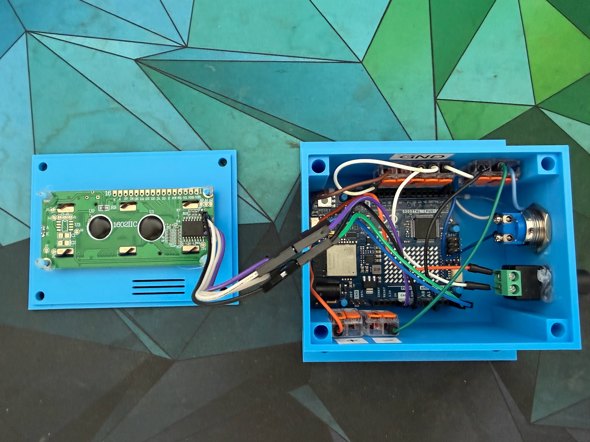
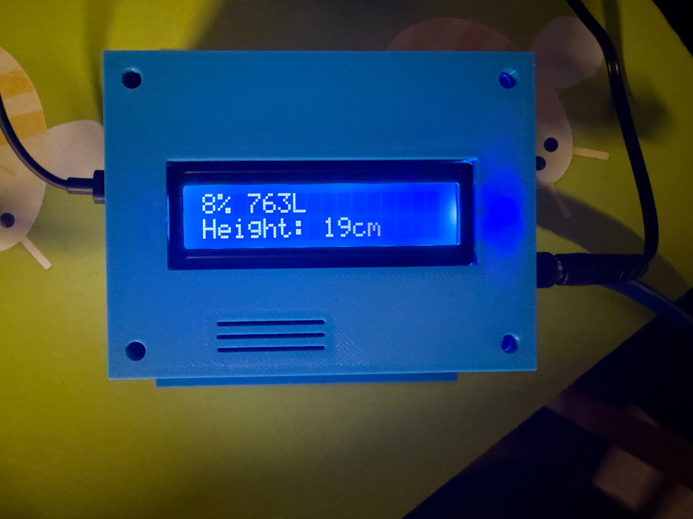
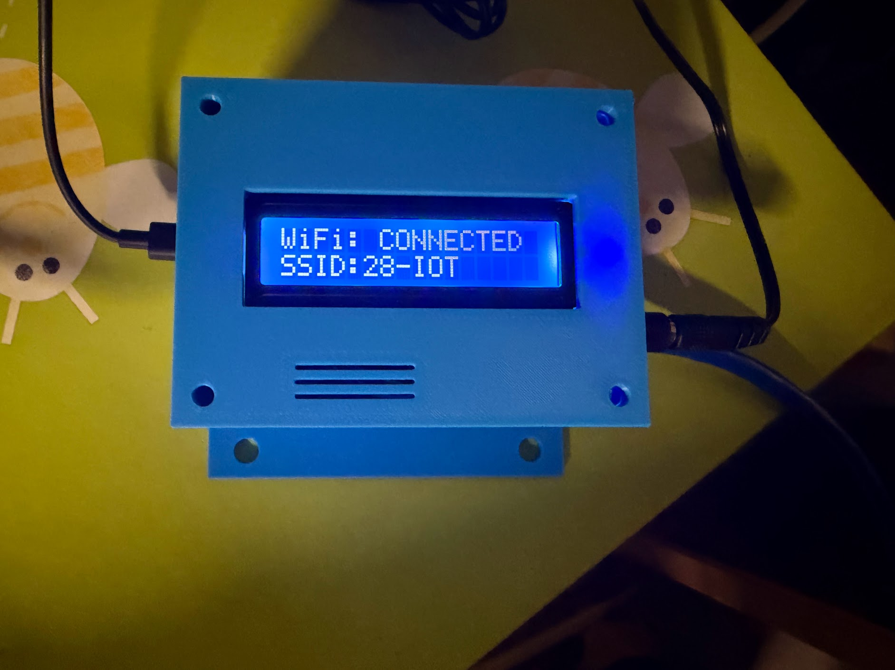

# Water Tank Monitor — Arduino UNO R4 WiFi

A Wi-Fi connected water tank monitor built with an **Arduino UNO R4 WiFi**, a **4–20 mA hydrostatic level sensor**, an **I²C 16×2 LCD**, and a **momentary push button**.

The project measures tank level, calculates percentage, water height and volume, exposes the data as JSON over HTTP, and can be integrated with systems such as **Loxone**.

The LCD normally stays off. A short button press turns it on for 5 minutes. Holding the button for 5 seconds shows Wi-Fi diagnostics such as connection status, SSID and IP address.

---

## Features

- 4–20 mA hydrostatic level sensor input
- Bursts of 100 ADC samples, with the 10 highest and 10 lowest discarded
- New sensor measurement every 5 seconds
- 5-minute rolling average to smooth out water surface movement and noise
- Trend arrow on the LCD (rising, falling or steady over the last 10 minutes)
- Wi-Fi connection using the UNO R4 WiFi
- HTTP JSON endpoint on port 80
- Water level as percentage, height and liters
- Sensor voltage and loop current diagnostics
- LCD display with tank status
- LCD backlight normally off
- Short button press: LCD turns on for 5 minutes
- Long button press for 5 seconds: shows Wi-Fi status, SSID and IP address
- Automatic Wi-Fi reconnect; LCD and button keep working when Wi-Fi is unavailable
- Sensor fault detection (cable break / short circuit)
- Suitable for Loxone Virtual HTTP Input integration

---

## Parts List

### Main Components

| Quantity | Part | Notes |
|---|---|---|
| 1 | Arduino UNO R4 WiFi | https://www.amazon.com.be/dp/B0C8V88Z9D?ref_=pe_151259421_1319653171_t_fed_asin_title |
| 1 | 4–20 mA hydrostatic level sensor | https://www.amazon.com.be/-/en/Liquid-Sensor-Transmitter-4-20mA-Detection/dp/B07G4B25BW/  |
| 1 | 24 V DC power supply | https://www.amazon.com.be/-/en/AGOTD-Adapter-220-240V-Inverter-Converter/dp/B0DRP7CS6Y?th=1 |
| 1 | 220 Ω resistor | Converts 4–20 mA loop current to a measurable voltage |
| 1 | 16×2 I²C LCD | To display the water level https://www.amazon.com.be/-/en/Freenove-1602-Display-Serial-Screen/dp/B0B76YGDV4 |
| 1 | 16 mm metal waterproof momentary push button | https://www.amazon.com.be/dp/B0DMFF8RBJ?ref_=pe_112122601_1111480491_t_fed_asin_title&th=1 |
| 1 | USB-C cable | For programming and powering the UNO R4 |
| 3 | WAGO connectors | To connect all cables|
| 1 | 3D printed case and lid | |

---

## Wiring

### 4–20 mA Sensor

The sensor is powered by the external 24 V supply.

```text
24V +  ───────────── Sensor +
                       |
                       |
Sensor - ──────────────+──── Arduino A0
                       |
                     220 Ω
                       |
24V 0V ────────────────+──── Arduino GND
```

Important:

- Arduino GND and the 24 V supply 0 V must share a common ground.
- Do **not** connect 24 V to the Arduino 5 V pin.
- The 220 Ω resistor converts the sensor current into voltage.

With a 220 Ω resistor:

```text
4 mA  × 220 Ω = 0.88 V
20 mA × 220 Ω = 4.40 V
```

This keeps the signal within the Arduino analog input range.

### LCD Wiring

```text
LCD GND → Arduino GND
LCD VCC → Arduino 5V
LCD SDA → Arduino SDA
LCD SCL → Arduino SCL
```

The sketch uses:

```cpp
LiquidCrystal_I2C lcd(0x27, 16, 2);
```

If your LCD does not respond, try address `0x3F`.

### Push Button Wiring

Use a **momentary Normally Open (NO)** button.

```text
Arduino pin 2 ───── Button ───── GND
```

The sketch uses the Arduino internal pull-up resistor:

```cpp
pinMode(lcdButtonPin, INPUT_PULLUP);
```

No external resistor is required.

Button behavior:

- Short press: LCD turns on for 5 minutes
- Hold for 5 seconds: Wi-Fi diagnostics are shown for 20 seconds
- Pressing the button again restarts the 5-minute LCD timer

---

## Required Arduino Libraries

Install these libraries in the Arduino IDE:

- `WiFiS3`
- `Wire`
- `LiquidCrystal_I2C`

`WiFiS3` is used by the Arduino UNO R4 WiFi.

Depending on the installed `LiquidCrystal_I2C` library, the Arduino IDE may show a warning such as:

```text
library LiquidCrystal I2C claims to run on avr architecture(s)
```

This is only a compatibility warning if the sketch still compiles. If the LCD does not work on the UNO R4, install a version of the library that supports the `renesas_uno` architecture.

---

## Wi-Fi Configuration

Open `waterput_LCD_Uno_R4_WIFI/waterput_LCD_Uno_R4_WIFI.ino` in the Arduino IDE and edit these lines:

```cpp
const char* wifiSsid = "YOUR_WIFI_NAME";
const char* wifiPassword = "YOUR_WIFI_PASSWORD";
```

After uploading the sketch, open the Serial Monitor at `115200 baud`.

You should see output similar to:

```text
Connecting to WiFi: HomeWiFi
....
WiFi connected.
SSID: HomeWiFi
IP address: 172.16.42.81
Signal strength: -52 dBm

Open in browser: http://172.16.42.81
HTTP server started.
```

If Wi-Fi is unavailable at startup, the Arduino continues without network after 15 seconds and keeps retrying every 10 seconds in the background. The LCD and button work in the meantime.

For reliable home automation integration, it is recommended to create a **DHCP reservation** in your router so the Arduino always receives the same IP address.

---

## Wi-Fi Diagnostics on the LCD

Hold the button for 5 seconds.

The LCD alternates between pages such as:

```text
WiFi: CONNECTED
SSID:HomeWiFi
```

and:

```text
IP address:
172.16.42.81
```

If Wi-Fi is unavailable:

```text
WiFi: OFFLINE
SSID:HomeWiFi
```

followed by:

```text
No connection
No IP address
```

## Measurement Configuration

The important settings are:

```cpp
const int numberOfMeasurements = 100;
const int numberOfTrimmedMeasurements = 10;
const int smoothingWindowSize = 60;
const unsigned long sensorMeasurementIntervalMs = 5000UL;
```

This means:

- Every 5 seconds, a burst of 100 ADC samples is taken
- The samples are sorted, and the 10 lowest and 10 highest are discarded to reject spikes (e.g. Wi-Fi transmit noise)
- The remaining 80 samples are averaged into one burst value
- The last 60 burst values (60 × 5 s = 5 minutes) are averaged in a rolling window

The reported value (`sensor.adc` and the water fields) is the 5-minute rolling average. It updates every 5 seconds, but a change in water level takes up to 5 minutes to be fully reflected. After a restart, the average is built from the bursts collected so far until the window is full. The latest burst without the rolling average is available as `sensor.adc_raw`.

The sensor fault check uses the latest burst, so a cable break is reported at once. During a fault the rolling average is reset, so fault values are never mixed into the level.

The trend arrow compares the level now with the level 10 minutes ago, sampled once per minute:

```cpp
const unsigned long trendSampleIntervalMs = 60000UL;
const float trendThresholdPercent = 1.0;
```

A change of at least 1 percentage point shows a rising or falling arrow; otherwise a dash. During the first 10 minutes after a restart the trend is steady.

The LCD refresh interval is:

```cpp
const unsigned long lcdRefreshIntervalMs = 60000UL;
```

The LCD therefore refreshes once per minute while it is active.

---

## ADC Resolution

The UNO R4 supports a higher ADC resolution, but this project currently uses:

```cpp
analogReadResolution(10);
```

This keeps the ADC scale compatible with the previous Arduino Uno calibration:

```text
0 ... 1023
```

---

## Reference Voltage

The sketch contains:

```cpp
const float arduinoReferenceVoltage = 5.00;
```

Measure the actual voltage between the UNO R4 **5V** and **GND** pins with a multimeter and update this value if necessary.

Example:

```cpp
const float arduinoReferenceVoltage = 4.93;
```

This improves the calculated sensor voltage and loop current.

---

## Calibration

The current calibration values are:

```cpp
const int adcEmpty = 196;
const int adcFull = 820;
```

These values define:

```text
adcEmpty → 0%
adcFull  → 100%
```

### Empty Calibration

With the tank empty, observe the averaged ADC value in the Serial Monitor and use it as:

```cpp
const int adcEmpty = VALUE;
```

### Full Calibration

With the tank at the desired full level, record the averaged ADC value and use it as:

```cpp
const int adcFull = VALUE;
```

---

## Tank Configuration

The example sketch uses:

```cpp
const float tankHeightCm = 250.0;
const float tankCapacityLiters = 10000.0;
```

Change these values to match your tank.

The current sketch assumes a linear relationship between water height and volume. This is correct for tanks with a constant cross-sectional area. For irregular or horizontal cylindrical tanks, use a different volume formula.

---

## LCD Display

During normal operation, the LCD shows:

```text
13% 1298L      ↑
Height: 33cm
```

The last character of line 1 is the trend: an arrow up (rising), an arrow down (falling) or a dash (steady). The arrows are custom LCD characters.

The LCD backlight is normally off. A short button press turns it on for 5 minutes.

---

## HTTP JSON API

Open the Arduino IP address in a browser:

```text
http://ARDUINO_IP/
```

Example:

```text
http://172.16.42.81/
```

The Arduino returns JSON similar to:

```json
{
  "device": {
    "name": "water_tank",
    "version": "2.3-r4wifi",
    "uptime_seconds": 1085
  },
  "calibration": {
    "adc_empty": 196,
    "adc_full": 820,
    "valid": true
  },
  "sensor": {
    "adc": 281.0,
    "adc_raw": 281.6,
    "voltage": 1.264,
    "current_mA": 5.743,
    "active": true
  },
  "wifi": {
    "connected": true,
    "rssi": -52
  },
  "water": {
    "percentage": 14,
    "height_cm": 34,
    "height_m": 0.341,
    "liters": 1362,
    "trend": "steady"
  }
}
```

The JSON request does **not** trigger a new ADC measurement. It always returns the latest 5-minute rolling average, which is updated every 5 seconds.

### Sensor Fault

If the loop current is below 3 mA (cable break, no 24 V) or above 21 mA (short circuit, sensor fault):

- `sensor.active` is `false`
- `water.percentage`, `water.height_cm`, `water.height_m` and `water.liters` are `-1`
- The LCD shows `SENSOR ERROR` and the measured loop current

This prevents a broken sensor from being reported as an empty tank. In Loxone, treat a value of `-1` as an alarm.

---

## JSON Fields

### Device

| Field | Description |
|---|---|
| `device.name` | Device name |
| `device.version` | Firmware version |
| `device.uptime_seconds` | Arduino uptime |

### Calibration

| Field | Description |
|---|---|
| `calibration.adc_empty` | ADC value representing empty |
| `calibration.adc_full` | ADC value representing full |
| `calibration.valid` | Whether calibration range is valid |

### Sensor

| Field | Description |
|---|---|
| `sensor.adc` | Rolling-average ADC value (5 minutes) |
| `sensor.adc_raw` | Latest burst ADC value (trimmed average of 100 samples, without the rolling average) |
| `sensor.voltage` | Calculated sensor voltage |
| `sensor.current_mA` | Calculated 4–20 mA loop current |
| `sensor.active` | `true` when the loop current is within 3–21 mA; `false` on a sensor fault |

### Wi-Fi

| Field | Description |
|---|---|
| `wifi.connected` | Wi-Fi connection status |
| `wifi.rssi` | Wi-Fi signal strength in dBm |

### Water

| Field | Description |
|---|---|
| `water.percentage` | Tank level percentage |
| `water.height_cm` | Water height in cm |
| `water.height_m` | Water height in m |
| `water.liters` | Calculated tank volume |
| `water.trend` | `rising`, `falling` or `steady`: change over the last 10 minutes, threshold 1 percentage point |

---

## Loxone Integration

Create a **Virtual HTTP Input** in Loxone Config.

Example URL:

```text
http://172.16.42.81
```

A polling cycle of 10–30 seconds is suitable for a water tank.

### Percentage

Create a Virtual HTTP Input Command with:

```text
"percentage": \v
```

Recommended settings:

```text
Unit: %
Minimum: 0
Maximum: 100
```

### Liters

```text
"liters": \v
```

Recommended settings:

```text
Unit: L
Minimum: 0
Maximum: tank capacity
```

### Height

```text
"height_cm": \v
```

Recommended settings:

```text
Unit: cm
Minimum: 0
Maximum: tank height
```

### Suggested Tank Statuses

A Loxone Status function block can be used to create human-readable tank states:

```text
0–10%    → Almost Empty
10–30%   → Low
30–80%   → Normal
80–100%  → Full
```

---

## Serial Monitor

The Arduino outputs diagnostics such as:

```text
ADC: 281.2 | Voltage: 1.374 V | Current: 6.246 mA | Water: 13.7 % | Height: 34.2 cm | Volume: 1368 L
```

This is useful for calibration, wiring checks, sensor diagnostics and Wi-Fi troubleshooting.

---

## License

This project can be released under the MIT License or another license of your choice.

If you publish it publicly, add a `LICENSE` file to the repository.

---


## Project Goal

This project is designed as a simple, stable and readable residential water-tank monitor with local Wi-Fi access, Loxone integration and easy on-device diagnostics.

## Pictures




